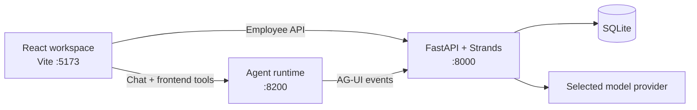

# Employee Operations Hub

Employee Operations Hub is a local employee-directory application with a modern React workspace, a FastAPI/SQLite backend, and an assistant that can safely act on the visible interface.

It is designed to demonstrate a practical human-in-the-loop workflow: the assistant can prepare an employee record, but a user must approve the exact record before the backend permits one matching write.

## Highlights

- Searchable employee directory with live department metrics.
- Manual employee registration with a review step.
- Assistant-driven browser actions: navigate, filter, open and fill forms, show employee details, refresh the directory, and render a department summary.
- Approval-token protection for create operations; the backend allows one matching write only after user approval.
- Selectable model provider: OpenAI, Groq, Grok (xAI), Anthropic, Amazon Bedrock, Ollama, or vLLM.
- Python dependencies managed with `uv`; frontend dependencies managed with pnpm.

## Architecture



The browser registers frontend tools with the runtime for visible UI actions. The assistant uses backend tools for employee facts and creation. Provider credentials stay exclusively on the backend.

## Quick start

### Prerequisites

- Python 3.12+
- [uv](https://docs.astral.sh/uv/)
- Node.js 22+ and pnpm
- A configured model provider, or a local Ollama/vLLM server

### Run the application

1. Copy the environment template.

   ```powershell
   Copy-Item .env.example .env
   ```

2. Edit `.env` and configure one provider and model.

3. Start all services from the repository root.

   ```powershell
   .\start-employee-operations-hub.ps1
   ```

4. Open [http://localhost:5173](http://localhost:5173).

Service endpoints:

- Frontend: `http://localhost:5173`
- Backend health check: `http://localhost:8000/health`
- Agent runtime: `http://localhost:8200/api/employee-operations`

The startup script runs `uv sync`, installs the pinned frontend packages, then launches the API, agent runtime, and Vite development server together.

## Model provider configuration

Set `LLM_PROVIDER` and `LLM_MODEL` in the root `.env`. Use `LLM_API_KEY` as a generic credential field, or use the selected provider-specific key. The frontend receives only the active provider and model name; it never receives credentials.

| Provider | `LLM_PROVIDER` | Credentials | Endpoint behavior |
| --- | --- | --- | --- |
| OpenAI | `openai` | `LLM_API_KEY` or `OPENAI_API_KEY` | Uses the OpenAI API by default. |
| Groq | `groq` | `LLM_API_KEY` or `GROQ_API_KEY` | Uses Groq's OpenAI-compatible API by default. |
| Grok (xAI) | `grok` | `LLM_API_KEY` or `XAI_API_KEY` | Uses xAI's OpenAI-compatible API by default. |
| Anthropic | `anthropic` | `LLM_API_KEY` or `ANTHROPIC_API_KEY` | Uses the native Strands Anthropic adapter. |
| Amazon Bedrock | `bedrock` | Standard AWS credentials, optionally `AWS_PROFILE` | Set `AWS_REGION`; `LLM_BASE_URL` is optional for a custom Bedrock endpoint. |
| Ollama | `ollama` | Optional `OLLAMA_API_KEY` | Defaults to `http://localhost:11434/v1`. |
| vLLM | `vllm` | Optional `VLLM_API_KEY` | Defaults to `http://localhost:8001/v1`; set `LLM_BASE_URL` for another server. |

### Examples

OpenAI:

```env
LLM_PROVIDER=openai
LLM_MODEL=gpt-4.1-mini
OPENAI_API_KEY=your_key_here
```

Groq:

```env
LLM_PROVIDER=groq
LLM_MODEL=qwen/qwen3.8-27b
GROQ_API_KEY=your_key_here
```

Ollama:

```env
LLM_PROVIDER=ollama
LLM_MODEL=llama3.2
```

vLLM on a custom address:

```env
LLM_PROVIDER=vllm
LLM_MODEL=Qwen/Qwen3-8B
LLM_BASE_URL=http://localhost:8001/v1
```

## Assistant capabilities

The assistant has two clearly separated tool types:

- **Frontend tools** update only the visible browser state: open or fill the registration form, filter or refresh the directory, navigate, show details, request approval, and render a summary.
- **Backend tools** access the SQLite directory: search employees, retrieve employee details, calculate department summaries, and create an employee after validating a one-time confirmation token.

Example requests:

- “Filter the employee directory to show only Sales employees.”
- “Show details for employee ID 1.”
- “Fill the employee form for Nila Joseph, nila.joseph@example.com, HR, People Partner, joining 2026-12-15. Do not submit it.”
- “Add Kavya Test, kavya.test@example.com, Finance, Financial Analyst, joining 2026-12-16. Fill the form and submit it.”

## Project layout

```text
.
├── backend/
│   ├── app/                 # FastAPI routes, Strands agent, model-provider factory
│   ├── tests/               # API, approval, and provider configuration tests
│   ├── pyproject.toml       # uv-managed Python project
│   └── uv.lock
├── frontend/
│   ├── src/                 # React workspace and browser tools
│   ├── server.ts            # Agent runtime server
│   └── package.json
├── .env.example             # Safe configuration template
└── start-employee-operations-hub.ps1
```

## Validation

```powershell
cd backend
uv run ruff check .
uv run pytest -q

cd ../frontend
pnpm run lint
pnpm run build
```

## Security notes

- Never commit `.env`, API keys, AWS credentials, local databases, or runtime logs.
- Keep all provider credentials on the server; do not use `VITE_` variables for secrets.
- Review every employee record before approving creation.
- Use a provider/model with reliable function-calling support for the assistant workflows.

## Dependency policy

Python is managed only through `uv`. Use `uv add` and commit both `backend/pyproject.toml` and `backend/uv.lock`; do not add a `requirements.txt` or install backend packages with `pip` directly.

The frontend is managed with pnpm.
